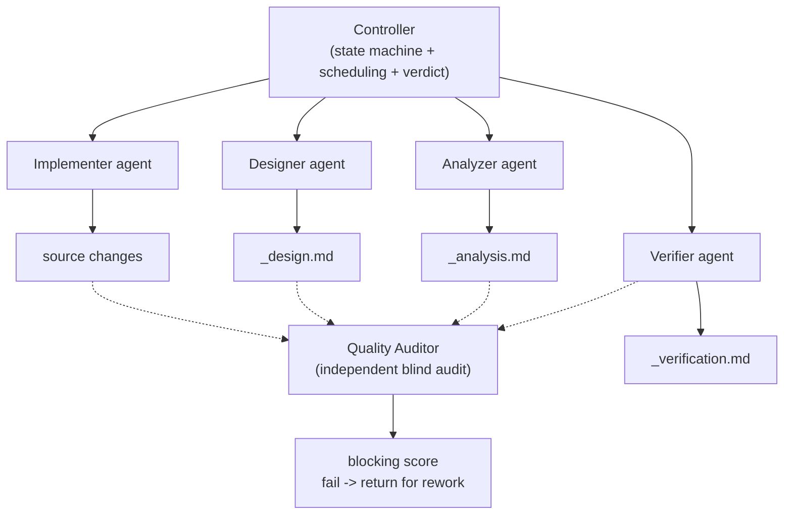

English | **[简体中文](README.md)**

# ReqPlan-v3 — Requirement Planning and Spec Engine for Software Delivery

> Turns "from requirement to release" into a pipeline that never skips a step and never loses work. The AI advances automatically, and resumes even after an interruption.

[](./SKILL.md)
[](./SKILL.md)
[](#license)

---

## What it is

You have probably lived through these project-management nightmares:

- **The requirement changed three times**, code was half-written, the direction turned out wrong, and rework followed
- **You shipped and only then noticed there was no documentation**, leaving the next person lost
- **The conversation was interrupted or the machine shut down**, and the AI forgot what it was doing
- **Bug fixing became whack-a-mole** — fix one thing, break another
- **Verification was skipped before release**, so quality depended on luck

**ReqPlan-v3 is the safety net for all of the above.** It turns software engineering into a pipeline with a strict order, quality gates and resumable state. The AI advances stage by stage — no skipping, no omissions.

---

## Core idea: Harness Engineering

> A harness puts reins on the AI so it runs on the right track instead of wherever it likes.

| Principle | Meaning |
| --- | --- |
| **Role boundaries** | Each agent does exactly one thing: analyse / design / implement / verify / audit |
| **State-machine driven** | Seven stages in strict order; no skipping, no backtracking except when a quality review rejects the work |
| **Artefact contracts** | Agents hand off through files, not conversation memory — so an interruption is always recoverable |
| **Quality gates** | Every stage is blind-audited by an independent Quality Auditor; a failure sends the work back |
| **Baton persistence** | `.agent/harness/_baton.md` records everything, enabling cross-session resumption |

---

## v6.1 artefact-path unification (2026-10-16)

Removes the difference in artefact location between TRAE and WorkBuddy:

- **Workspace-root resolution**: (1) the path the user specified → (2) walk up to the nearest directory containing `.trae/` or `.workbuddy/` → (3) fall back to the current working directory
- **Fixed location**: all artefacts go to `{workspace root}/.agent/harness/`, independent of IDE
- `{project path}` is uniformly defined as "workspace root"

## v6.0 paradigm refactor (2026-10-16)

The change moved from "write everything into the main document" to "thin main document, read details on demand":

| Change | Description |
| --- | --- |
| Main document slimmed | `SKILL.md` cut from 531 to about 205 lines, keeping only operational instructions |
| Content moved down | Safety rules, FAQ and out-of-scope scripts moved into `reference/`, read only when needed |
| On-demand routing added | A "if you hit X, read this file" routing table is built into the main document |
| Constraints restated | Threat-style phrasing and stacked emoji replaced with statements that cannot be misread |
| Guards merged | "activate and execute / mandatory entry checklist / first-response guard" merged into one section |
| Evidence grading | Observation / inference / unknown three-level grading replaces some prescriptive constraints |
| Single version source | Version unified to v6.0 across `SKILL.md`, manifest and README |
| Closing section | Added "re-check the original list + explicit stop condition" |

---

## Key capabilities

| Capability | Description |
| --- | --- |
| **On-demand reading** | The main document covers "how to proceed"; depth is loaded via the routing table |
| **7-stage automatic advance** | START → ANALYZE → CONFIRM → DESIGN → IMPLEMENT → VERIFY → JUDGE → DONE |
| **Multi-agent collaboration** | Analyzer / Designer / Implementer / Verifier / QA each own their stage |
| **Resumable runs** | After an interruption or shutdown, the next session reads the baton and restores progress |
| **Five-layer verification** | Static checks → unit tests → build and integration → exception handling → process compliance |
| **Independent quality review** | A Quality Auditor sub-agent blind-audits and blocks progress on failure |
| **Six-dimension final verdict** | JUDGE accepts or rejects across requirement analysis, architecture design, implementation, test coverage, verification report and process compliance |
| **User-interruption handling** | Reset immediately / record as TODO / discuss only |
| **Self-targeting review** | Can audit and repair a skill itself (meta tasks) |

---

## Quick start (30 seconds)

### Option 1: natural language (recommended)

Say to your agent:

> "Add user login with JWT authentication to the project at e:/my-app"

→ ReqPlan-v3 starts the full pipeline: analyse the requirement → produce a design → implement → verify → judge.

Or be explicit:

> "Run the full ReqPlan flow and implement file upload in my-app"

### Option 2: slash command

```bash
/reqplan start                 # Start the wizard and choose a flow
/reqplan init                  # Initialise the .agent/harness/ directory
# To resume after an interruption, send /reqplan start again
```

### Option 3: name the flow type

| What you want | What to say |
| --- | --- |
| A new project from zero to acceptance | "Create a blog system at e:/new-project" |
| Fix a bug | "Fix the token-expiry problem in login.ts" |
| Refactor code | "Refactor order-service into microservices" |
| Design review only | "Review this database design" |
| Add documentation | "Write API documentation for this project" |
| Test improvements | "Add unit tests for user-service" |

### Resuming after an interruption

```
You:     "Where did I get to?"
ReqPlan: (reads the baton) -> currently in DESIGN; requirement analysis is complete, awaiting the technical design
You:     "Continue"
ReqPlan: resumes automatically from DESIGN...
```

---

## State machine

```
START --> ANALYZE --> CONFIRM --> DESIGN --> IMPLEMENT --> VERIFY --> JUDGE --> DONE
            |            |          |           |            |           |
            |  user      |          |           |            |           |
            |  confirm   |          |           |            |           |
            |  yes -->   |          |           |            |           |
            |  no  --> ABORT        |           |            |           |
            v                       v           v            v           v
        revise requirement      QA audit    QA audit     QA audit    six-dimension verdict
        (back to ANALYZE)       (rework)    (rework)     (rework)    (reject/pass)
```

| State | Advance mode | Key checkpoint |
| --- | --- | --- |
| START | automatic | baton created |
| ANALYZE | automatic | quality review blocks |
| CONFIRM | **waits for the user** | confirm / revise / cancel |
| DESIGN | automatic | quality review blocks |
| IMPLEMENT | automatic | quality review blocks |
| VERIFY | automatic | independent blind audit blocks |
| JUDGE | automatic | six-dimension final verdict |
| DONE | terminal | a new task resets to START |

---

## Multi-agent architecture



**Collaboration flow**

1. The controller reads the baton to determine the current state
2. It dispatches the matching agent per the state routing table
3. The agent reads upstream artefacts and produces the current stage's artefact
4. The Quality Auditor reviews it; only a pass allows the next stage
5. The controller updates the baton and advances automatically

---

## When to use it, when not to

| Use it for | Do not use it for |
| --- | --- |
| A new project from requirement to release (recommended) | Simple questions (just ask the AI) |
| Structured bug fixing (preventing fix-A-break-B) | One-off trivial coding (renaming a variable does not need this) |
| Code refactoring that needs architectural assessment | Report or dashboard generation (use conspect) |
| Design review (independent blind audit of your design) | Operation manual generation (use ManualGen) |
| Development tasks that are frequently interrupted | Skill auditing (use skill-medic) |
| Projects needing strict quality gates | — |

---

## Artefact structure

```
{project path}/.agent/harness/
├── _baton.md                     # Baton (state + progress + task tracking)
├── _analysis.md                  # Requirement analysis report
├── _design.md                    # Technical design document
├── _implementation.md            # Implementation summary
├── _verification.md              # Verification report
├── _quality_audit_analysis.md    # Analysis quality review
├── _quality_audit_design.md      # Design quality review
├── _quality_audit_implement.md   # Implementation quality review
├── _quality_audit_verify.md      # Verification quality review
└── _quality_audit_judge.md       # Final global verdict
```

**The baton is the centrepiece**: ask "progress" at any time and the AI reads it to tell you the current stage, what the previous stage produced, what comes next, and whether anything was rejected and why.

---

## Directory layout

```
ReqPlan-v3/
├── SKILL.md                   # Entry (single version source, operational instructions only)
├── SKILL-execution.md         # Stage detail: checkpoints, skip prevention, appendix templates
├── README.md                  # This file (Chinese)
├── README.en.md               # This file (English)
├── 1-manifest/skill-manifest.yaml
├── 6-docs/changelog.md
├── agents/                    # analyzer / designer / implementer / verifier / quality-auditor
├── quality-control/00-quality-system.md
├── protocols/baton-protocol.md
├── artifacts/template-artifacts.md
├── SKILL.chunks/              # On-demand chunks + index
└── reference/                 # anti-patterns, debug-guide, faq, faq-deep, out-of-scope, security-safety
```

---

## Five-layer verification

| Layer | Content | Notes |
| --- | --- | --- |
| Layer 1 | Static checks | Code conventions, type checks, file completeness |
| Layer 2 | Unit tests | Core function correctness, boundary conditions, error paths |
| Layer 3 | Build and integration | Compile checks, dependency install, build output |
| Layer 4 | Exception handling | Retry on failure, rollback strategy, degraded behaviour |
| Layer 5 | Process compliance | Chain records, decision log, constraint register |

---

## Design references

- [Harness Engineering article](https://mp.weixin.qq.com/s/AFX_qsyAPBRYyqEV365O9Q)
- [testerhome Harness design](https://testerhome.com/articles/44066)

---

## License

MIT
